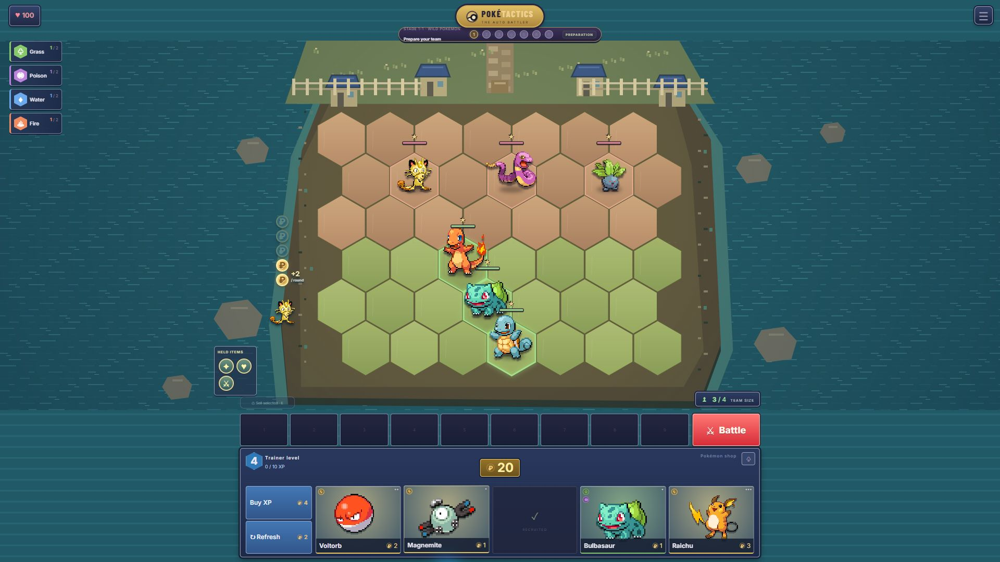

# PokeTactics

A browser-based Pokémon autobattler inspired by Teamfight Tactics. Build a team, combine copies, equip items, scout seven bot trainers and reposition on a hex battlefield to become the last trainer standing.



## Run locally

Requires **Node.js 24 or newer** and npm.

```sh
npm ci
npm run dev -- --port 5174
```

Open [localhost:5174](http://127.0.0.1:5174/). To check a production build:

```sh
npm run build
npm run preview
```

## Features

- 27 Pokémon with animated local sprites, distinct abilities, six combat roles and eight type synergies.
- Eight-trainer leagues with a shared shop pool, upgrades, scouting, drafts, interest, streak income and health elimination.
- Exclusive hex movement: living Pokémon reserve their origin and destination, and face their movement or attack target.
- Six item components and 21 recipes; three held-item slots, equal seeded wild-round drops and bot equipment.
- Island arena with an integrated HUD, Meowth's interest markers, reserve bench and shop.
- Drag a Pokémon over the shop to preview its sale value; release to sell and recover its held items.
- Seeded battle sandbox, deterministic replays, ability previews and damage/healing/shield reports.

## Controls

| Action | Control |
| --- | --- |
| Position a Pokémon | Drag between board and bench, or select then click a hex |
| Ready / continue | Battle button or Space |
| Refresh shop | D; costs 2 gold |
| Buy XP | F; costs 4 gold for 4 XP |
| Sell | Drag over the shop and release, or select a unit and press E |
| Equip / craft | Select an item then a Pokémon; select two components to craft |
| Inspect a Pokémon | Right-click |
| Scout, replay, sandbox, settings | Corner menu |
| Cancel selection or an arena overlay | Escape |

Progress saves in this browser. Use `?test-run=1` for a separate QA match.

## Documentation

- [Gameplay and economy](docs/GAMEPLAY.md)
- [Architecture and replay format](docs/ARCHITECTURE.md)
- [Balance experiments](docs/BALANCING.md)
- [Development and contributions](CONTRIBUTING.md)
- [GitHub publication](docs/PUBLISHING.md)
- [Asset credits and rights](CREDITS.md)

## Validation

```sh
npm test
npm run build
npm run audit:run
npm run audit:damage
npm run audit:formations
npm run audit:mixed
```

The current suite contains 90 tests. Full-match audits check legal purchases, gold, deployment caps, the shared pool, exclusive tiles and independent replay checksums. Audit output is written to ignored `artifacts/` files. Matchup results are composition benchmarks; they do not establish universal win rates.

This is a local fan prototype with bot opponents. Online multiplayer and hosted deployment are future work. Pokémon and its artwork belong to their respective rights holders; see [CREDITS.md](CREDITS.md).
